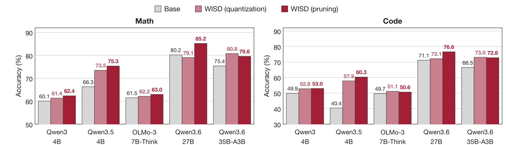
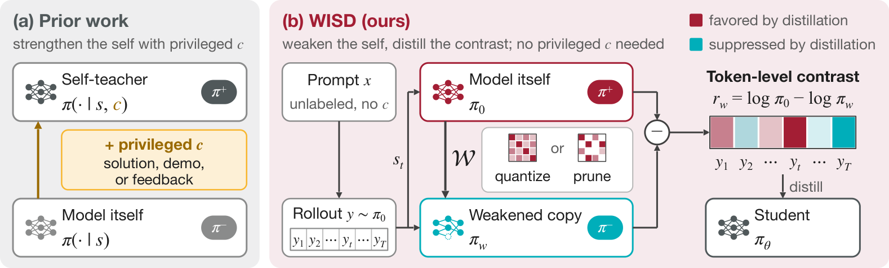
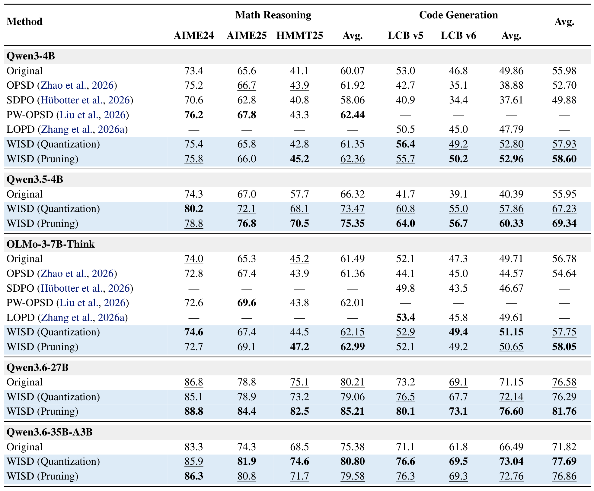

# Weaken to Strengthen: Weakening-Induced On-Policy Self-Distillation for Large Reasoning Models

<div align="center">
  <a href="https://arxiv.org/abs/2610.38681"></a> &ensp;
  <a href="https://huggingface.co/papers/2610.38681"></a> &ensp;
  <a href="https://jet-ai-projects.github.io/WISD"></a>
</div>

<p align="center">
  <a href="assets/teaser.pdf"></a>
</p>

## 💡 Introduction

**WISD (Weakening-Induced On-Policy Self-Distillation)** improves a reasoning
model using a weaker copy of itself. The original-minus-weak log-probability
contrast supplies training signals on the original model's own trajectories,
without an external teacher or privileged information. On Qwen3.5-4B, pruning
raises HMMT 2025 accuracy from **57.7% to 70.5%** and LiveCodeBench v6 accuracy
from **39.1% to 56.7%**.

WISD constructs a frozen weaker self in two training-free ways:

- **Low-bit quantization:** Reduce weight precision to create an informative contrast with the original model.
- **Magnitude pruning:** Remove small-magnitude weights and restore row norms to construct the weak model.

<p align="center">
  <a href="assets/overview.pdf"></a>
</p>

The paper evaluates Qwen3-4B, Qwen3.5-4B, OLMo-3-7B-Think, Qwen3.6-27B,
and Qwen3.6-35B-A3B on AIME 2024, AIME 2025, HMMT 2025, and LiveCodeBench
v5/v6. Across the 25 model–benchmark settings, quantization and pruning
improve average accuracy by **4.0 and 5.5 percentage points**, respectively.

<p align="center">
  <a href="assets/results.pdf"></a>
</p>

Accuracy is reported as Avg@32 for mathematics and Avg@4 for code. The final
average weights all five benchmarks equally. Bold and underlined values
denote the best and second-best reported results per model; a dash denotes
an unavailable result. See the [paper](https://arxiv.org/abs/2610.38681) for
the full experimental setup.

This repository contains the weak-model operators, cached scoring pipeline,
offline DOPD training runtime, checkpoint conversion, and mathematics/code
evaluation tools. **Qwen3-4B is the complete reference workflow.** The shared
runtime also includes Qwen3.5 and OLMo training adapters. See
[model coverage](#model-coverage) for their scope.

### Contents

- [Method](#method)
- [Installation](#installation)
- [Qwen3-4B workflow](#qwen3-4b-workflow)
- [Code training](#code-training)
- [Evaluation](#evaluation)
- [Model coverage](#model-coverage)
- [Repository map](#repository-map)
- [Tests](#tests)
- [Acknowledgements and license](#acknowledgements-and-license)
- [BibTeX](#bibtex)

## Method

1. Generate trajectories from the original model on unlabeled prompts.
2. Construct a weak scorer using **RTN3 with group size 128**, or
   **group magnitude pruning with threshold max-absolute-weight / 6** and
   whole-row L2-norm restoration.
3. Score the same prefixes and token candidates with the frozen original
   and weak models.
4. Train a student initialized from the original checkpoint on the cached
   contrast. Only the student is needed at inference time.

For a state `s` and token `a`, the contrast is
`r(a | s) = log p_original(a | s) - log p_weak(a | s)`.
The offline DOPD target is `q ∝ p_behavior * exp(r / alpha)`, with `alpha=2`.
The implementation retains the original Top16 support, full-vocabulary
normalization, and an OTHER bucket with zero reward. The loss follows
[Lightning Weave](https://github.com/jet-ai-projects/Lightning-Weave).

## Installation

```bash
git clone https://github.com/jet-ai-projects/WISD.git
cd WISD
```

Use separate environments for data curation, distributed training, and
evaluation so that their GPU dependencies can be matched to the model.

**Data curation and scoring** require Python 3.10+, PyTorch, Transformers,
and vLLM:

```bash
python -m pip install -e '.[curation,test]'
```

The reference Qwen3-4B scoring implementation uses Transformers 4.57.6.
Install a compatible vLLM/PyTorch build for rollout collection.

**Training** uses the included Slime runtime with Megatron-LM, Ray,
Transformer Engine, and SGLang. A container launcher is provided:

```bash
bash run_docker.sh
# Inside the container:
python -m pip install -e .
```

Alternatively, prepare the GPU stack described in `requirements-train.txt`
and [training details](docs/training.md). The reference training recipe
uses one node with eight GPUs. Run commands below from the repository root.

## Qwen3-4B workflow

### 1. Prepare prompts and the original checkpoint

In the curation environment:

```bash
export STUDENT_MODEL="$(hf download Qwen/Qwen3-4B)"
export TASK=math
export RUN_DIR="$PWD/outputs/qwen3-4b-math"
export WEAK_ANCHOR=rtn3_g128

hf download Skywork/Skywork-OR1-RL-Data \
  data/math-00000-of-00001.parquet \
  --repo-type dataset --local-dir data/skywork-or1

SOURCE_INPUT="$PWD/data/skywork-or1/data/math-00000-of-00001.parquet" \
  bash scripts/prepare_data.sh
```

`STUDENT_MODEL` is a local Hugging Face snapshot. All scoring roles and
student initialization use this original checkpoint.

### 2. Generate and score trajectories

```bash
bash scripts/collect_rollouts.sh
bash scripts/score_anchors.sh
```

The default cache contains four responses for each of 3,200 prompts.
Rollouts use temperature 1.0, top-p 1.0, and a 2,048-token response limit.
Scoring runs the original model, weak model, and original reference
sequentially and writes a sealed cache under
`$RUN_DIR/anchors/$WEAK_ANCHOR/final`.

For the pruning variant, reuse the rollout cache with a different anchor:

```bash
export WEAK_ANCHOR=group_prune_g128_tau1of6_rownorm
bash scripts/score_anchors.sh
```

The original model remains unchanged. Weakening is applied in memory to
the frozen pre-scorer, using FP32 transform arithmetic and BF16/FP16 model
forwards. Use a fresh run directory when changing prompts or checkpoints.
See [data pipeline details](docs/data_pipeline.md) for the cache schema and
scoring options.

### 3. Train and export the student

In the training environment, set the same `STUDENT_MODEL`, `TASK`,
`RUN_DIR`, and `WEAK_ANCHOR` values. Make those paths available inside the
container if using one.

```bash
export MODEL_TYPE=qwen3-4B
export NUM_GPUS=8

OUTPUT_DIR="$PWD/checkpoints/qwen3-4b-initial" \
  bash scripts/convert_checkpoint.sh to-megatron

export DATA_DIR="$RUN_DIR/anchors/$WEAK_ANCHOR/final"
export LOAD_DIR="$PWD/checkpoints/qwen3-4b-initial"
export SAVE_DIR="$PWD/checkpoints/qwen3-4b-$WEAK_ANCHOR"

bash scripts/train.sh --dry-run
bash scripts/train.sh

INPUT_DIR="$SAVE_DIR/iter_0000049" OUTPUT_DIR="$SAVE_DIR-hf" \
  bash scripts/convert_checkpoint.sh to-hf
```

The default recipe uses a global batch size of 64, learning rate `1e-6`,
and **200 optimizer updates**. The exported directory contains the
student checkpoint used for evaluation. See [training details](docs/training.md)
for configuration, checkpointing, and the additional training adapters.

## Code training

Train a separate code student using KlearReasoner-CodeSub-15K:

```bash
export TASK=code
export RUN_DIR="$PWD/outputs/qwen3-4b-code"
export WEAK_ANCHOR=rtn3_g128
hf download Kwai-Klear/KlearReasoner-CodeSub-15K \
  --repo-type dataset \
  --revision f6c935197e097ab144d5517a62cc498e0209e060 \
  --include 'default/train/*.parquet' --local-dir data/codesub15k

SOURCE_INPUT="$PWD/data/codesub15k/default/train" \
  bash scripts/prepare_data.sh
bash scripts/collect_rollouts.sh
bash scripts/score_anchors.sh
```

Then repeat the training/export steps with a code-specific `SAVE_DIR`.
The code pipeline samples 3,200 prompts, four responses per prompt, and
uses a 4,096-token prompt limit. Dataset configuration and filtering are
documented in [data pipeline details](docs/data_pipeline.md).

## Evaluation

The evaluation tools cover AIME24, AIME25, HMMT25, and LiveCodeBench v5/v6.
Defaults are **Avg@32 for mathematics**, **Avg@4 for code**, a 40,960-token
output limit, and a 49,152-token context window. Accuracy averages
individual sampled responses, not pass@32 or pass@4.

In a separate evaluation environment, install `requirements-eval.txt`
and a compatible vLLM build:

```bash
python -m pip install -r requirements-eval.txt

MODEL=checkpoints/student-math-hf MATH_PROMPT_FAMILY=qwen3 \
  OUTPUT_DIR=results/math bash evaluation/eval_math.sh
```

For code, install the upstream LiveCodeBench package as described in
[evaluation details](docs/evaluation.md), then generate responses:

```bash
python -m evaluation.livecodebench_v6.lock_dataset \
  --release-version release_v6 --output data/evaluation/lcb-v6.lock.json

python -m evaluation.generate_code \
  --model checkpoints/student-code-hf \
  --dataset-lock data/evaluation/lcb-v6.lock.json \
  --chat-format codeqwen --output results/code/v6-generations.json
```

The evaluation guide covers v5, prompt selection, official code grading,
and result summaries. Use the mathematics student for math and the code
student for code, with matched original-model baselines.

## Model coverage

| Component | Included support |
|---|---|
| RTN and pruning matrix operators | Reusable tensor functions |
| Model-level weak construction and scoring | Ordinary Qwen3-4B, with its projection inventory checked explicitly |
| Training | Qwen3-4B, plus Qwen3.5-4B and OLMo-3-7B-Think adapters for compatible scored caches |
| Evaluation | Model-configurable math/code launchers and prompt families |

The paper evaluates five models. The model-level weak-scoring adapter in
this release is validated for Qwen3-4B. Extending it to another architecture
requires specifying that model's projection inventory and backend.

## Repository map

```text
assets/                    Paper figures and main results (PNG and PDF)
self_distillation/anchors/   RTN, magnitude pruning, and row-norm restoration
self_distillation/scoring.py Original/weak identity and precision checks
data_curation/              Prompt preparation, rollouts, scoring, cache manifests
configs/wisd/train.py       WISD training configuration and launcher
slime/ + slime_plugins/     Shared offline DOPD training runtime
scripts/                   Prepare, collect, score, train, and convert commands
evaluation/                Mathematics and LiveCodeBench evaluation
tests/                     CPU numerical and pipeline regression tests
docs/                      Data, training, and evaluation guides
```

## Tests

```bash
python -m pip install -e '.[test]'
python -m pytest -q
```

The CPU suite checks weak transformations, full-vocabulary scoring,
cached-target losses, pipeline commands, and evaluation metrics. Distributed
training tests require the corresponding Megatron stack. GPU training and
evaluation are run separately from these tests.

## Acknowledgements and license

This code builds on [Lightning Weave](https://github.com/jet-ai-projects/Lightning-Weave),
[Lightning OPD](https://github.com/jet-ai-projects/Lightning-OPD), and
[Slime](https://github.com/THUDM/slime). The repository is distributed under
the [Apache License 2.0](LICENSE). See [NOTICE](NOTICE) and
[third-party notices](THIRD_PARTY_NOTICES.md) for inherited attribution.
Model weights and datasets are downloaded separately under their own licenses.

## BibTeX

```bibtex
@article{wu2026wisd,
  title={Weaken to Strengthen: Weakening-Induced On-Policy Self-Distillation for Large Reasoning Models},
  author={Wu, Yecheng and Han, Song and Cai, Han},
  journal={arXiv preprint arXiv:2610.38681},
  year={2026}
}
```
